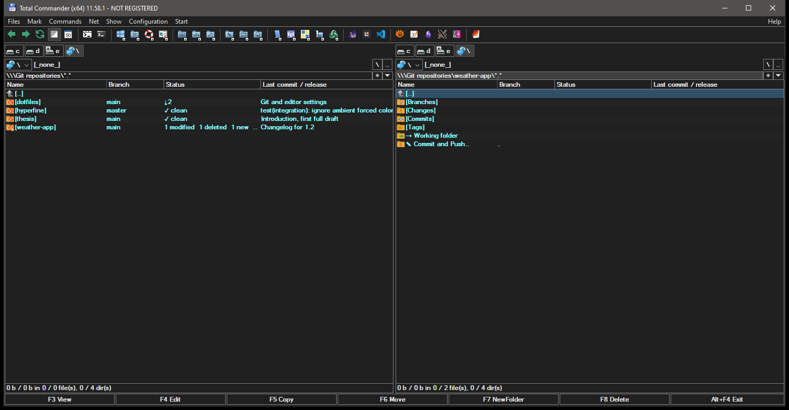
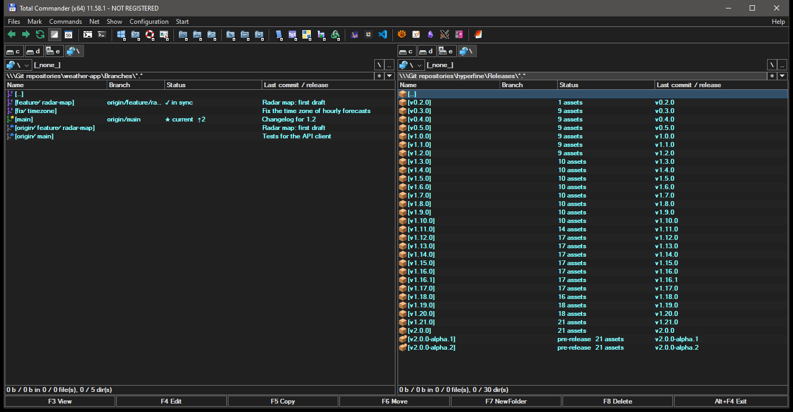
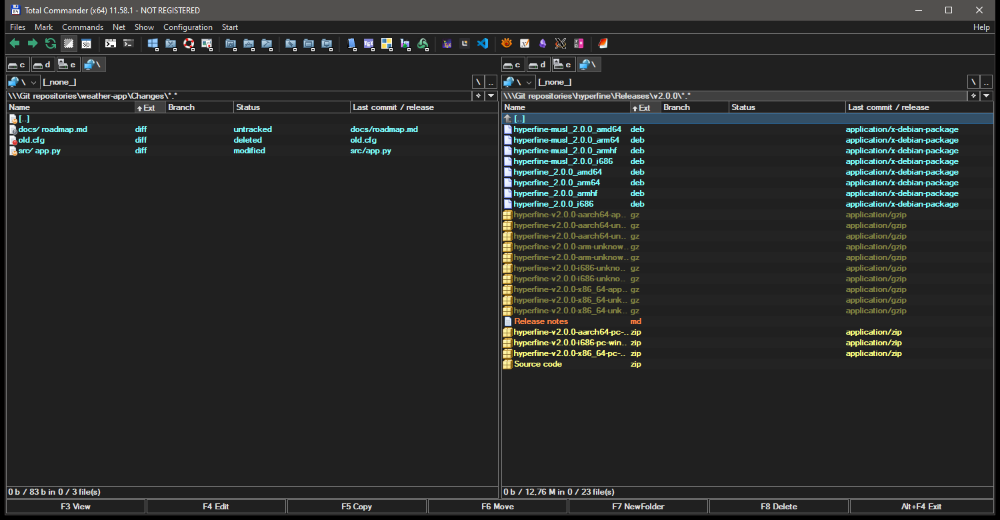
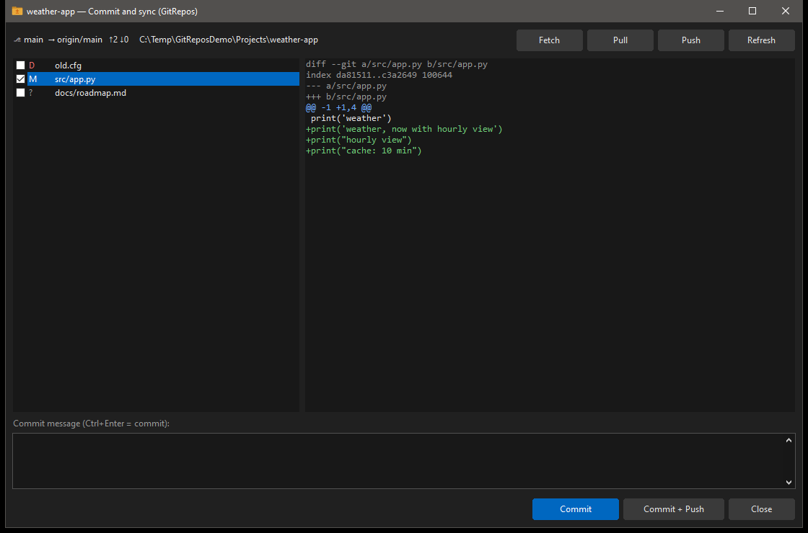
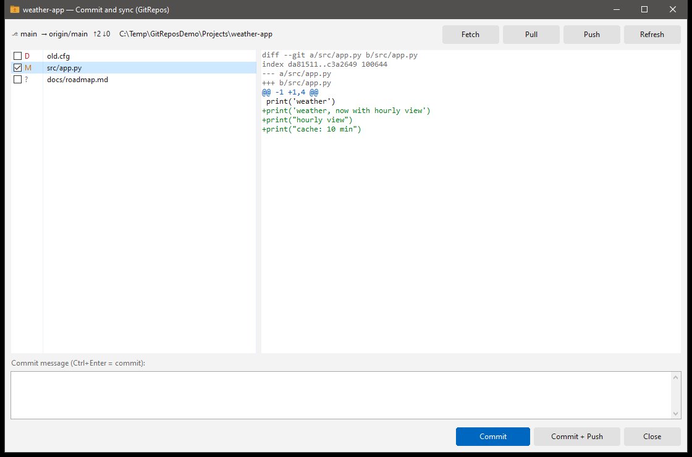
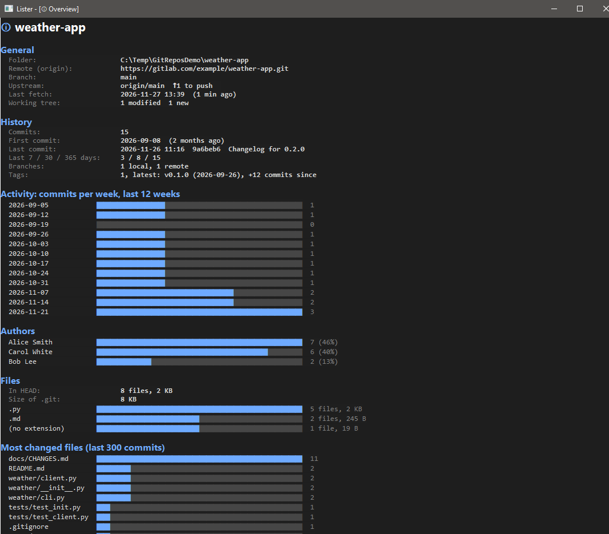
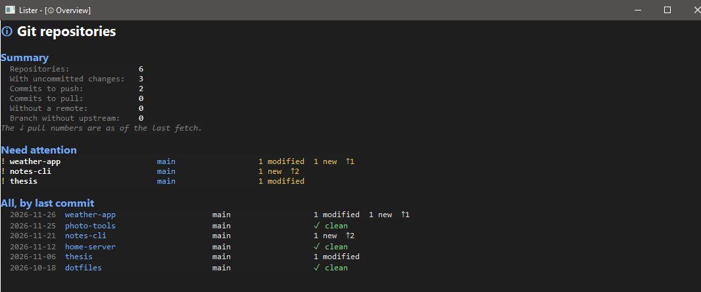
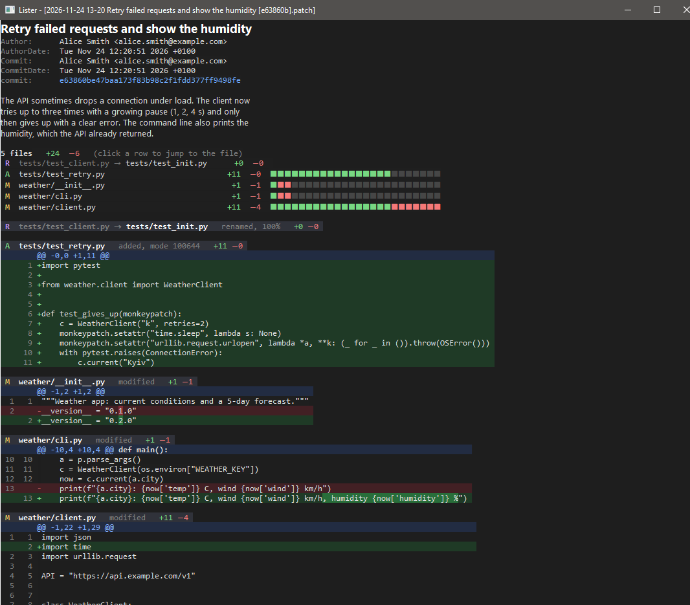
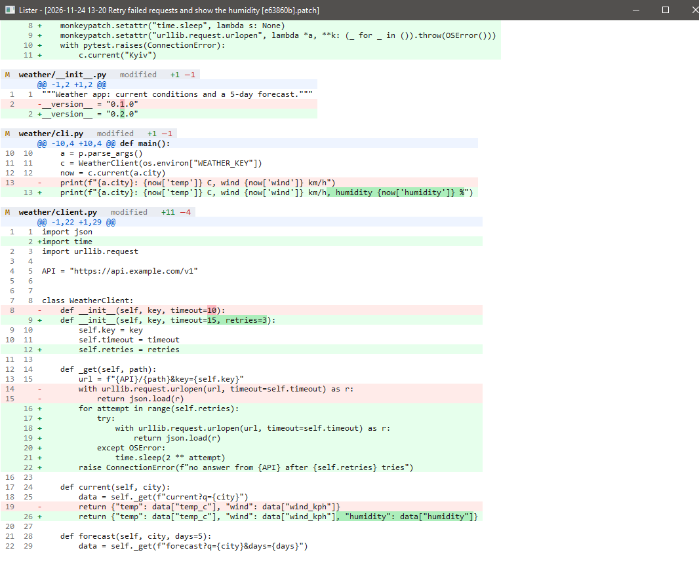

# GitRepos — git repositories in Total Commander

**GitRepos** is a file system plugin (WFX) for [Total Commander](https://www.ghisler.com/) that shows all your git repositories as one virtual folder: their state at a glance, branches, tags, GitHub releases, commits and uncommitted changes, plus a small window to commit, pull and push without leaving Total Commander. The same DLL is also a **Lister plugin** that shows `.patch` and `.diff` files in colour.

- **Finds your repositories by itself.** No list to keep up to date: it looks through your projects folder.
- **Shows the state of every repository** in columns: branch, `✓ clean` / `3 modified 1 new`, `↑2` to push, `↓3` to pull, the last commit.
- **ⓘ Overview** of all repositories and of each one: history, activity, authors, file types, the most changed files.
- **Branches, tags, releases** as folders, with their files, release assets and notes.
- **Patch viewer**: commits and diffs with line numbers, tinted added / removed lines and the changed words marked.
- **Commit and Push window** in the Total Commander theme (light or dark).
- **Own icons** for every kind of item.
- 32-bit and 64-bit, English / Ukrainian / Russian (follows Total Commander), only system DLLs, needs nothing but `git`.

Freeware. Version **1.1**. [Download](https://github.com/sergiokapone/tc-gitrepos/releases/latest)

[](https://send.monobank.ua/jar/7EiyaxfeWZ) — GitRepos is free; if it saves you time, a small donation helps to keep it going.



---

## Contents

- [Installation](#installation)
- [What you see](#what-you-see)
  - [The root: all repositories](#the-root-all-repositories)
  - [Inside a repository](#inside-a-repository)
  - [Branches and tags](#branches-and-tags)
  - [Releases (GitHub)](#releases-github)
  - [Commits and Changes](#commits-and-changes)
  - [Commit and Push window](#commit-and-push-window)
  - [Overview](#overview)
- [Patch viewer (Lister)](#patch-viewer-lister)
- [Columns](#columns)
- [Keys](#keys)
- [Settings](#settings)
- [Speed](#speed)
- [Safety and privacy](#safety-and-privacy)
- [Limits](#limits)
- [Changelog](#changelog)
- [License](#license)
- [Support](#support)

---

## Installation

1. Download `GitRepos-1.1.zip` from the [releases page](https://github.com/sergiokapone/tc-gitrepos/releases/latest).
2. Open the zip in Total Commander (Enter on it) and confirm the installation. Total Commander copies the plugin to `plugins\wfx\GitRepos` and registers it.
3. Open **Network Neighborhood** (the "Network" button of the drive bar, or type `\\\` in the command line) and enter **Git repositories**.
4. Recommended: also install the patch viewer, `GitRepos-Lister-1.1.zip`, the same way. Then commits, diffs and the overviews open in colour (without it they open as plain text). Total Commander puts a new Lister plugin at the end of the list; if another viewer (for example a text or syntax viewer) takes `.patch` files first, move **GitRepos** up in *Configuration › Options › Plugins › Lister plugins (.WLX) › Configure*.

Manual installation: copy `GitRepos.wfx` and `GitRepos.wfx64` into one folder and add it under *Configuration › Options › Plugins › File system plugins (.WFX) › Add*; for the viewer add `GitRepos.wlx64` / `GitRepos.wlx` under *Lister plugins (.WLX)*.

**Requirements:** Total Commander (tested with 11.58, 64-bit; the 32-bit build is included), [Git for Windows](https://git-scm.com/download/win) (`git.exe` in `PATH`, or `Git=` in the ini). Optional: the [GitHub CLI](https://cli.github.com/) logged in (`gh auth login`), then releases of private repositories work and GitHub allows 5000 requests an hour instead of 60.

## What you see

### The root: all repositories

Every git repository found in your projects folder is a folder of its own. By default GitRepos searches `<drive of Total Commander>\Projects` five levels deep; change it with `Roots=` (several folders allowed) and add single repositories elsewhere with `Repos=` (see [Settings](#settings)). A repository inside another repository is not searched; list it in `Repos=`.

The icon tells the state before you read anything:

| Icon | Meaning |
|---|---|
|  | clean, nothing to push |
|  | uncommitted changes |
|  | commits not pushed yet |

The columns show the current branch, the state (`✓ clean`, `1 modified 1 deleted 1 new ↑2`, `↓2`), the last commit message, author, origin URL and the working folder. The state of all repositories is read in the background, several at once, so the folder opens immediately and the columns fill in within a second or two.

### Inside a repository

| Item | What it is |
|---|---|
| **Branches** | local and remote branches |
| **Tags** | all tags |
| **Releases** | the GitHub releases (only for repositories whose `origin` is on GitHub) |
| **Commits** | the last 300 commits of the current branch |
| **Changes** | uncommitted files (shown only when there are any) |
| **→ Working folder** | Enter jumps to the real folder of the repository |
| **✎ Commit and Push...** | Enter opens the [commit window](#commit-and-push-window); F3 shows `git status` |
| **ⓘ Overview** | F3 or Enter: the [overview](#overview) of this repository |

### Branches and tags



- Local branches and remote branches (`origin∕main`; `∕` stands for `/`, which a file name cannot contain).
- The **current branch** has its own icon (a star) and `★ current` in the Status column; remote branches have a cloud icon.
- Status: `↑2` commits to push, `↓3` to pull, `✓ in sync`, or `upstream gone`. The Branch column shows the upstream.
- **Enter on a branch or tag opens its files** as they are in that commit, without checking anything out. F3 views a file, F5 copies files or whole folders out. Nothing in your working folder changes.

### Releases (GitHub)

- One folder per release (tag name; the date column is the publication date); pre-releases and drafts have their own icon and are marked in the Status column with the number of assets; the *Downloads* column sums the download counts.
- Inside: every **asset** (size, date, download count; F5 downloads it with Total Commander's progress bar), **Release notes.md** (title, tag, date, author, assets, and the release text) and **Source code.zip** (the archive GitHub makes for the tag).
- Releases are cached for 10 minutes; **Ctrl+R** in the Releases folder asks GitHub again.

### Commits and Changes



- **Commits**: `2026-11-25 09-15 Changelog for 1.2 [1503754].patch`. **Enter or F3 shows the commit** (message, author, changed files and the full patch) in Lister; F5 saves it as a `.patch` file.
- **Changes**: every uncommitted file as `path.diff`, with an icon for its kind (modified, added, deleted, untracked) and the state in the Status column. **F3 shows the diff** against the last commit; **Enter opens the commit window** with this file selected.

### Commit and Push window



Enter on **✎ Commit and Push...** (or on a file in **Changes**) opens a window in the colours of Total Commander (light or dark):

- **Left:** the changed files with a check box. **Checked = in the next commit** (`git add`), unchecked = not (`git restore --staged`). Click the box, press Space or double-click.
- **Right:** the coloured diff of the selected file.
- **Bottom:** the commit message; **Commit** (Ctrl+Enter) and **Commit + Push**. When no file is checked, the window offers to commit all changes.
- **Top:** the branch with `↑ ↓`, and **Fetch**, **Pull** and **Push**. Pull only fast-forwards (`git pull --ff-only`), so it never creates a merge commit behind your back. The first push of a new branch sets its upstream (`git push -u origin HEAD`).
- Right-click a file: open it, show it in its folder (Total Commander), copy the path, check all / uncheck all, add it to `.gitignore`.
- What git says (errors included) appears in the right pane; network commands run in the background, the window stays responsive. Esc closes, F5 refreshes; afterwards the panel shows the new state.



**The window never deletes or reverts anything.** There is no "discard changes" on purpose. If git needs a login for push or pull, the Git Credential Manager window appears as usual; git never waits for console input.

### Overview

Total Commander does not ask a file system plugin anything on F3 on a folder, so the root and every repository have an entry **ⓘ Overview**. F3 or Enter opens it (in colour with the [patch viewer](#patch-viewer-lister), as text without it); F5 copies it as a text file.



- **A repository:** folder, remote, GitHub page, branch and upstream (`↑ ↓`), last fetch, working tree, stash; history (commits, first and last, last 7 / 30 / 365 days, branches, tags with the latest one and the commits since, GitHub releases with downloads); commits per week for 12 weeks; authors; files by type and the size of `.git`; the most changed files of the last 300 commits; the last 15 commits.
- **The root:** how many repositories have uncommitted changes, commits to push or pull, no remote or no upstream; the ones that need attention; all of them by last commit.



`Overview=0` in the ini removes the entries.

## Patch viewer (Lister)

The same DLL, installed as a Lister plugin (`GitRepos-Lister-1.1.zip`), shows `.patch`, `.diff` and `.rej` files: what Commits and Changes give, `git format-patch` files, saved `git diff` / `git log -p` output and plain unified diffs from any tool. It also draws the overviews.



- **Commit card:** subject, author and dates, hash, the message. A series of commits (`git log -p`, several format-patch mails) shows one card per commit.
- **File table:** status (added, modified, deleted, renamed, binary), `+added −removed` and a bar; **click a row to jump to that file**.
- **Every file** gets a banner with its status, old → new name, similarity and mode change; hunks show the **old and new line numbers**; added and removed lines are tinted, and inside a changed line **the changed words are marked** in a stronger colour.
- Keys: **]** / **[** next / previous file, **L** line numbers on/off, **W** wrap long lines, Ctrl+C / Ctrl+A, Lister's search (F7); N / P go to the next / previous file of the panel as usual. Right-click gives the same as a menu.
- Light and dark theme and the language follow Total Commander. A patch of a megabyte opens in about 0.2 s.



## Columns

The plugin offers these fields to Total Commander (*Configuration › Options › Custom columns*, choose the plugin **Git repositories**, or right-click the column header in the plugin):

| Field | Repository | Branch / tag | Commit | Change | Release / asset |
|---|---|---|---|---|---|
| **Branch** | current branch | upstream | | | |
| **Status** | `✓ clean`, `2 modified 1 new ↑1` | `★ current ↑2`, `✓ in sync`, `↓3` | | modified / added / deleted / untracked | `pre-release 21 assets` |
| **Commit** | short id of HEAD | short id | short id | | |
| **Subject** | last commit message | last commit message | message | path | release title / asset type |
| **Author** | author of the last commit | author of the last commit | author | | release author / uploader |
| **Remote** | origin URL | | | | release page / download URL |
| **Path** | working folder | | | | |
| **Downloads** | | | | | download count |

The plugin also suggests a default column set (Branch, Status, Last commit, Size, Date); `DefaultColumns=0` in the ini turns that off.

## Keys

| Where | Key | Action |
|---|---|---|
| anywhere | **Alt+Enter** | open the item on GitHub (repository, branch, file, commit, release); for repositories without GitHub: go to the working folder |
| root | **Ctrl+R** | look for repositories again and re-read all states |
| a repository folder | **Ctrl+R** | re-read this repository |
| Releases | **Ctrl+R** | ask GitHub again |
| a file in a branch, tag, release | **F3 / F5** | view / copy out |
| Commits, Changes | **Enter / F3** | patch / diff in Lister (Enter on a change opens the commit window) |
| commit window | **Ctrl+Enter**, **F5**, **Esc** | commit, refresh, close |
| ⓘ Overview | **Enter / F3** | the overview in Lister |
| patch viewer | **]** / **[**, **L**, **W** | next / previous file, line numbers, wrap |

## Settings

Everything works without settings. To change something, copy `GitRepos.ini.example` to `GitRepos.ini` next to the plugin:

```ini
[GitRepos]
; folders searched for repositories (";"-separated, %VARIABLES% allowed); default: <drive of TC>\Projects
Roots=D:\Projects;E:\Work
; how deep to look inside Roots
Depth=5
; single repositories anywhere else (";"-separated)
Repos=D:\Tools\dotfiles
; also take the repositories listed in gitview.json (the gitview plugin), 0 = no
ImportGitview=1
; git.exe; empty = from PATH, then Program Files\Git\cmd\git.exe
Git=
; GitHub token for releases; empty = the GitHub CLI login (gh auth token) when UseGhToken=1
Token=
UseGhToken=1
; commits in the Commits folder, releases asked from GitHub
Commits=300
Releases=50
; "Source code.zip" in every release folder
SourceZip=1
; the plugin's default columns, 0 = Total Commander's usual columns
DefaultColumns=1
; parallel git processes for the root (0 = number of CPUs, at most 8)
Threads=0
; "ⓘ Overview" in the root and in every repository, 0 = no
Overview=1
; theme of the commit window and the patch viewer: light / dark / auto (= Total Commander)
Theme=auto
; uk / ru / en / auto (= Total Commander)
Language=auto

[View]
; the patch viewer (these two are also switched with L and W and remembered)
LineNumbers=1
Wrap=0
FontSize=10
```

The patch viewer reads the `GitRepos.ini` next to its own DLL (`plugins\wlx\GitRepos`); `Theme` and `Language` can go there too.

Coming from the **gitview** plugin: GitRepos reads the repositories of your `gitview.json` too (`ImportGitview=1`), so nothing gets lost; once they are in `Roots=` / `Repos=`, set it to 0.

## Speed

- The list of repositories is a plain folder scan (no git started), cached for 30 seconds.
- The state of a repository is two quick git commands (`status`, `log -1`); the origin URL is read straight from `.git\config`. All repositories are done in parallel in the background; a state is kept for 30 seconds and dropped at once when git itself changes something (commit, checkout, fetch, ...).
- Lists of branches, tags, commits and changes are parsed once and reused for every icon and column.
- Typical numbers: 80 repositories with all columns in about 2 seconds in the background; opening the root again about 30 ms; 300 commits about 0.1 s. The first visit to a Releases folder waits for GitHub (about 0.5 s), then 10 minutes from the cache.
- Changes you make outside git (editing a file) show up after at most 30 seconds, or at once with Ctrl+R.

## Safety and privacy

- **Read-only, except the commit window.** Browsing never writes to a repository; `git status` runs with `--no-optional-locks`, so it never blocks your own git. The commit window only stages, unstages, commits, fetches, pulls (fast-forward only) and pushes. Nothing is deleted or reverted.
- **Network:** only `api.github.com` (release lists), `github.com` / `codeload.github.com` (downloads you ask for) and whatever `git fetch/pull/push` contacts. No telemetry, no update checks.
- **Token:** with `UseGhToken=1` the plugin asks the GitHub CLI for its token (`gh auth token`) and sends it only to `api.github.com`, never to the download servers; it is kept in memory only, never written anywhere.

## Limits

- Releases are GitHub only (no GitLab / Gitea yet).
- A repository nested inside another repository is not found by the scan; add it to `Repos=`.
- Commits shows the current branch only; the files of other branches are in **Branches**.
- Total Commander shows `∕` (U+2215) instead of `/` in branch and path names, and `꞉` instead of `:`.
- Git LFS files are shown as their pointer files inside branches and tags.

## Changelog

### 1.1 (2026-11-27)
- **Patch viewer** (Lister plugin, `GitRepos-Lister-1.1.zip`): commit cards, a clickable file table with bars, file banners, old / new line numbers, tinted lines, changed words marked; `]` `[` `L` `W`.
- **ⓘ Overview** in the root and in every repository.
- The version is in the DLL (`version=` in `pluginst.inf`).

### 1.0 (2026-11-26)
First public version.

## License

Freeware: free for private and commercial use; you may share the unchanged zip. The source code is not published. See [LICENSE](LICENSE).

Bugs and ideas: [issues](https://github.com/sergiokapone/tc-gitrepos/issues).

## Support

GitRepos is free and has no ads or paid version. If it saves you time, you can support its development:

- **[monobank jar](https://send.monobank.ua/jar/7EiyaxfeWZ)** (cards of any bank, Apple Pay / Google Pay),
- or the **Sponsor** button at the top of this repository.

A star on GitHub and a word on the Total Commander forum help too. Thank you!
